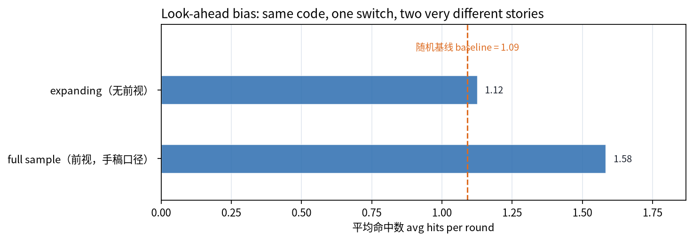
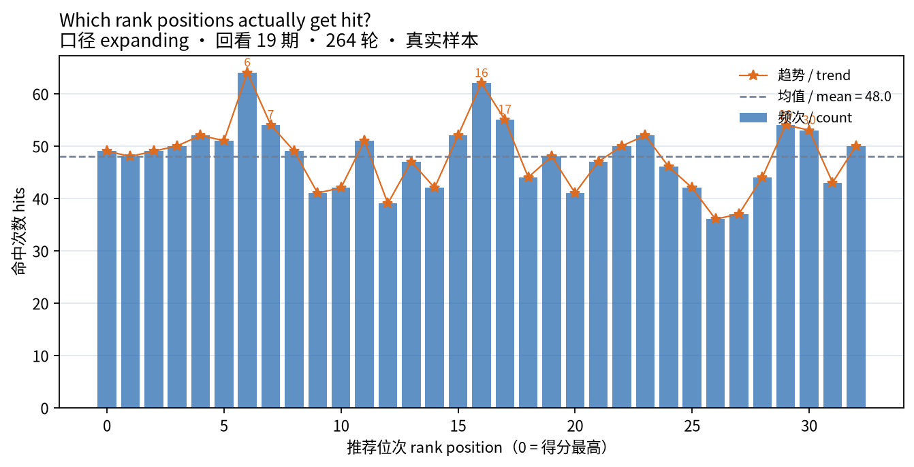
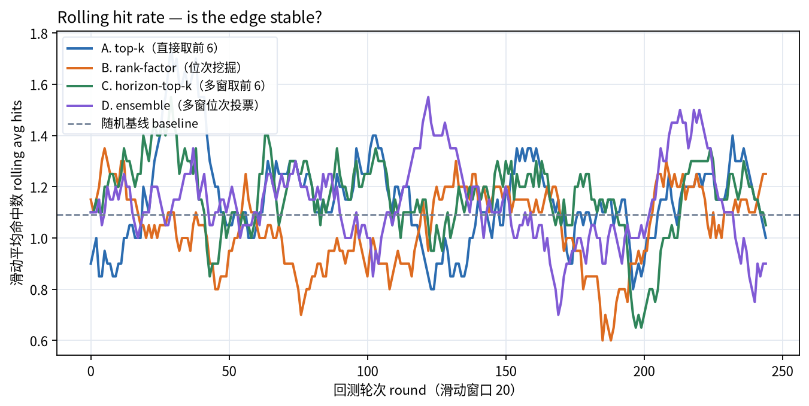

# Lottery-Select-Lab / SSQ-Number-Engine / Number-Picking-Lab

[](https://www.python.org/)
[](LICENSE)
[](tests)
[](CONTRIBUTING.md)

**A reproducible research workbench for red-ball combination selection** —
neighbourhood-diffusion scoring, rank-position factor mining, and multi-horizon consensus
voting, wired into one framework with a built-in **look-ahead-bias detector**.

> 中文完整版文档：[README_ZH.md](README_ZH.md)

---

## The honest part first

Lottery draws are independent random events. You cannot predict them, and this repo does not
claim to. What it *can* show you is something far more useful:

**how easily a plausible-looking back-test fooled its own author.**

The original handwritten scripts mined "which rank positions tend to hit" over the **entire
dataset** — including the very issues they were about to predict. Switching that one knob off
changes the story completely:



| Variant | Avg hits / round | vs blind pick |
| --- | --- | --- |
| `mode="expanding"` (leakage-free) | **1.12** | 1.03× |
| `mode="full"` (handwritten口径, uses future data) | **1.58** | 1.45× |

Same code, same data, one flag — a 41% inflation that looks exactly like a working strategy.
That experiment ships as a runnable demo (`examples/03_leakage_demo.py`) on **283 real issues**
(2025-01-02 → 2026-11-17), and CI asserts that the leaky variant can never score *below* the
honest one.

---

## What's inside

| | |
| --- | --- |
| **Scoring primitive** | Each draw is projected onto a 33-dim vector: drawn numbers get `hit`, their neighbours get `diffusive`. Sum the last `L` issues to score a target issue. |
| **Three strategies** | `topk` (trust the score), `rank-factor` (trust the *position*), `ensemble` (trust the *consensus* of 19 horizons). |
| **Leakage control** | `expanding` vs `full` is a first-class config flag, not an afterthought. |
| **Analysis** | Rank-hit frequency, hit distribution vs hypergeometric baseline, rolling hit curves, strategy comparison. |
| **Recommendation** | `predict_next()` — the empty `start_prediction()` stub from the handwritten version, finally implemented, with vote-level transparency. |
| **Engineering** | Typed API, bilingual docstrings, 44 unit tests, CLI, CSV/JSON export, zero hard-coded paths. |



---

## Quick start

```bash
git clone https://github.com/ZDMmin/lottery-select-lab.git
cd lottery-select-lab
pip install -r requirements.txt
pip install -e .              # makes `python -m lottery_select_lab` available

# 1) run every demo (< 6 s total), artifacts land in examples/output/
python scripts/run_demo.py

# 2) compare all four strategies on the bundled sample
python -m lottery_select_lab compare --data data/sample/ssq_sample.csv --charts
```

<details>
<summary>As a library / 作为库调用</summary>

```python
from lottery_select_lab import BacktestConfig, load_draws, run

draws = load_draws("data/sample/ssq_sample.csv")   # 283 real issues, 2025-01-02 ~ 2026-11-17
cfg = BacktestConfig(hit=2.0, diffusive=1.0, top_k=6, lookback=19,
                     horizons=range(1, 20), mode="expanding")

result = run("ensemble", draws, cfg)
print(result.average_hits, result.baseline_hits)   # 1.08 vs 1.09 -> no edge
```

```python
from lottery_select_lab.predict import predict_next

prediction = predict_next(draws, cfg)
print(prediction.explain())     # 6 numbers + votes + per-expert breakdown
```
</details>

### CLI

```bash
python -m lottery_select_lab generate-data --n 400 --seed 7 --out data/synthetic.csv
python -m lottery_select_lab backtest --data data/sample/ssq_sample.csv --strategy rank-factor --charts
python -m lottery_select_lab compare  --data data/sample/ssq_sample.csv --charts
```

---

## Results on the bundled sample (283 real issues, 264 rounds)

| Strategy | Avg hits | Hit rate | Baseline | Lift | z |
| --- | --- | --- | --- | --- | --- |
| A. `topk` | 1.133 | 0.189 | 1.091 | 1.04× | 0.78 |
| B. `rank-factor` | 1.042 | 0.174 | 1.091 | 0.95× | −0.92 |
| C. `horizon-top-k` | 1.152 | 0.192 | 1.091 | 1.06× | 1.13 |
| D. `ensemble` | 1.125 | 0.188 | 1.091 | 1.03× | 0.64 |

**Read this table as the point, not as a failure.** On real draws every strategy collapses onto
the analytic baseline `6 × 6/33 ≈ 1.09`. The best-looking lift (C, 1.06×) sits **1.13 standard
errors** from the baseline — well inside noise. That is exactly what the framework should
report, and it is why the repository's value is methodological, not predictive.

The `z` column is computed analytically, not bootstrapped: each round's hit count follows
`Hypergeometric(33, 6, 6)` because the prediction set is fixed before the draw, so
`z = (avg − baseline) / sqrt(var/n)`. `|z| < 2` means "this is luck".

The rolling curves show all four strategies oscillating around the baseline with no persistent
separation:



---

## Repository layout

```
lottery-select-lab/
├── src/lottery_select_lab/      # the package
│   ├── models.py                #   Draw / BacktestConfig / BacktestResult
│   ├── data.py                  #   loader (csv/txt, messy delimiters) + synthetic generator
│   ├── weights.py               #   diffusion weight vectors, window sums, decay
│   ├── ranking.py               #   rank order, top-k, rank-position picks, voting
│   ├── metrics.py               #   hits, distribution, baseline, lift
│   ├── backtest.py              #   four strategies + incremental factor tracker
│   ├── predict.py               #   next-issue recommendation
│   ├── viz.py                   #   charts (bilingual labels, CJK-safe)
│   ├── report.py                #   CSV / JSON / Markdown export
│   └── cli.py                   #   argparse entry point
├── examples/                    # 4 runnable demos + generated output samples
├── scripts/                     # run_demo.py, download_data.py
├── docs/                        # ALGORITHM.md, REFACTOR_NOTES.md
├── legacy/handwritten_v1/       # the original 6 scripts, preserved verbatim
├── data/sample/                 # 283 real issues, committed for reproducible demos
└── tests/                       # 44 pytest cases
```

### Why `legacy/` is in the repo

The six original scripts (`test.py` … `test_5.py`) are kept untouched. They document how the
idea evolved, and every refactored function can be checked against its handwritten ancestor.
The full mapping table lives in [docs/REFACTOR_NOTES.md](docs/REFACTOR_NOTES.md).

---

## Data

The repo ships `data/sample/ssq_sample.csv` — **283 real issues** (2025-01-02 → 2026-11-17),
about 12 KB — so every demo reproduces the numbers in this README offline and out of the box.
Larger histories are git-ignored; fetch them with:

```bash
# from a remote text/csv source
python scripts/download_data.py --url <your-source-url> --out data/ssq_history.csv

# or normalize a local export you already have
python scripts/download_data.py --from-file ~/Desktop/彩票研究/data_3.txt --out data/ssq_history.csv
```

Accepted format (delimiters auto-detected; reds may be space/slash/plus separated):

```
issue,date,reds,blue
2025001,2025-01-02,2 3 17 18 22 33,16
```

`data/raw/` and large CSVs are git-ignored — see `.gitignore`.

---

## Where the value is

1. **A leakage detector you can reuse.** `mode="expanding"` vs `mode="full"` on any
   window-based ranking idea tells you within a second whether your edge is real.
2. **An incrementally maintained factor tracker.** 300 issues × 19 horizons went from
   minutes to under a second, verified bit-for-bit against a from-scratch recomputation.
3. **A clean migration example.** Six copy-pasted scripts → one typed package, with the
   original kept for audit — including a written list of the 15 flaws found and fixed
   ([docs/REFACTOR_NOTES.md](docs/REFACTOR_NOTES.md#3-重构中修掉的问题--issues-fixed)).
4. **Charts that explain themselves.** Every figure carries an English title and a Chinese
   subtitle, and a baseline rule so a reader can judge it without reading the code.

---

## Roadmap

- [ ] Fold in the follow-up factor family (`rule1-4`, `band`, `repeat`) — v2 batch in progress
- [ ] Co-occurrence graph features (Node2Vec-style embeddings over the 33-number graph)
- [ ] Walk-forward / nested validation harness
- [ ] Notebook walkthrough: *why lottery numbers cannot be predicted*
- [ ] English + Chinese docs for every module

---

## Contributing

Issues and PRs are welcome. Please run `python -m pytest -q` and `python scripts/run_demo.py`
before opening a PR. See [CONTRIBUTING.md](CONTRIBUTING.md).

## Disclaimer

This project is a **statistics and software-engineering exercise**. It does not predict lottery
results, does not improve the odds of any ticket, and must not be used as gambling advice.
Lottery play carries financial risk — if gambling stops being fun, seek help.

## Acknowledgements

The research ideas, experiment design and the original handwritten scripts (`legacy/handwritten_v1/`)
are the author's own work. The refactoring, unit tests, documentation and generated demo artifacts
in this repository were produced with **Doubao Work (豆包办公)**, an AI assistant, under the
author's direction and review — every number in this README is reproducible from the committed
code and the committed sample data.

If you build on this work, a link back is appreciated but not required.

## License

[MIT](LICENSE)
