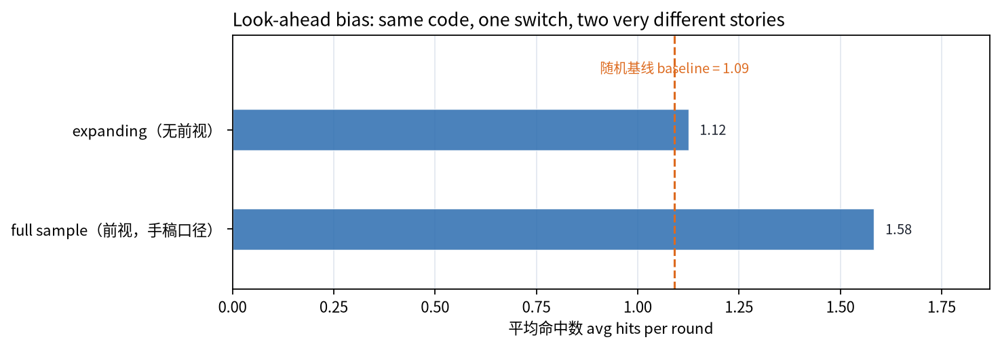
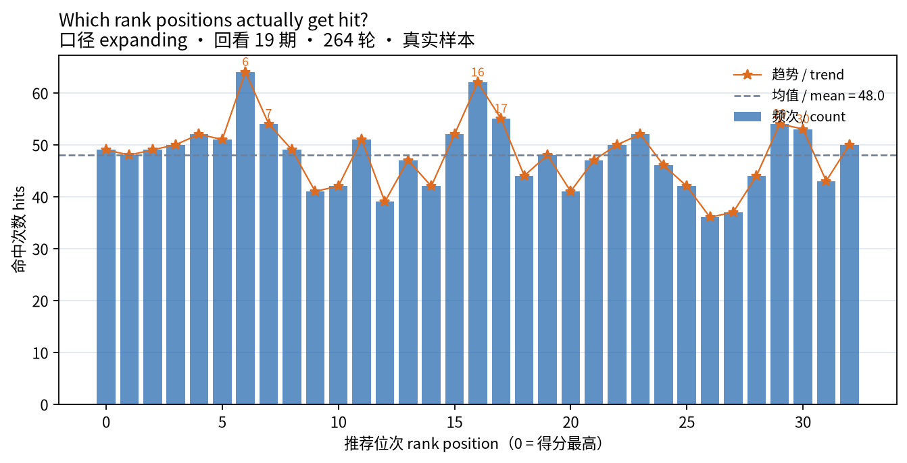
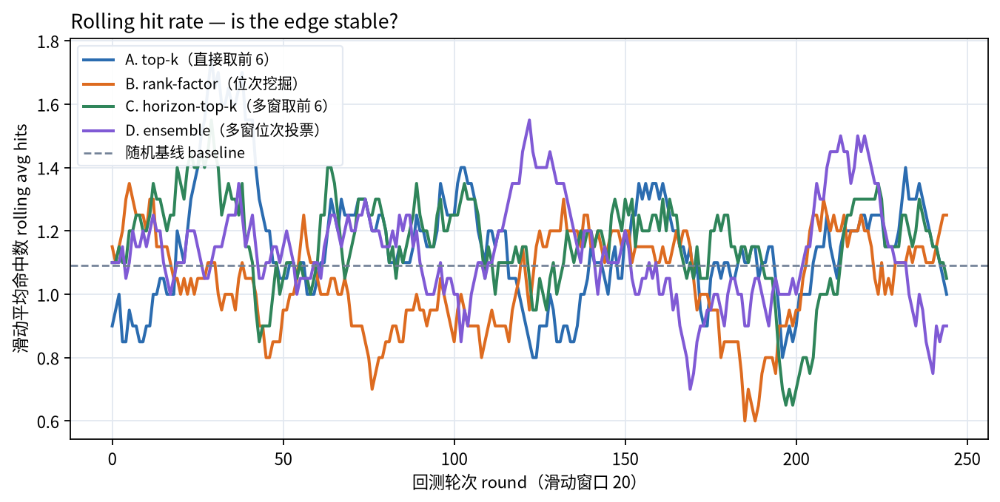

# Lottery-Select-Lab / SSQ-Number-Engine / Number-Picking-Lab

[](https://www.python.org/)
[](LICENSE)
[](tests)

**一套可复现的双色球红球组合研究工作台**——
邻域扩散打分、位次因子挖掘、多窗口共识投票，统一在一个框架里，
并内置一个**前视偏差检测器**。

> English version: [README.md](README.md)

---

## 先说结论，不粉饰

彩票开奖是独立随机事件，不能预测，这个仓库也没有声称能预测。
它真正想说明的是另一件更有价值的事：

**一个看起来很靠谱的回测，是怎么把自己骗过去的。**

最早那批手写脚本在挖掘"哪些位次容易命中"时，遍历了**全量历史**——
包括它马上要预测的那几期。把这个开关关掉，故事立刻变了：



| 口径 | 每期平均命中数 | 相对盲选 |
| --- | --- | --- |
| `mode="expanding"`（无前视） | **1.12** | 1.03× |
| `mode="full"`（手稿口径，看得到未来） | **1.58** | 1.45× |

同一份代码、同一批真实数据（283 期，2025-01-02 ~ 2026-11-17）、只改一个开关，命中数被虚增 41%。
这个实验做成了可直接运行的 demo（`examples/03_leakage_demo.py`），
并且 CI 里有一条测试断言：**泄漏口径的分数不可能低于诚实口径**。

---

## 引擎在算什么

### 1. 评分原语：邻域扩散

一期开奖（6 个红球）投影成一个 33 维权重向量：

- 开出的号码 `d` → 位置 `d-1` 加 `hit`
- 左右邻居 `d±1` → 各自加 `diffusive`
- 1 号没有左邻、33 号没有右邻，**不做环形回绕**

把过去 `L` 期的向量累加，就得到当期 33 个号码的得分，降序排列即当期排序。
同分时号码小的在前，保证可复现。

这一步背后的假设是"号码存在邻域惯性"。假设成立与否，交给回测判断，不靠直觉。

### 2. 三种策略

| 策略 | 排序依据 | 本质 |
| --- | --- | --- |
| `topk` | 当期得分前 k 名 | 直接信任得分 |
| `rank-factor` | 统计"第几位最容易命中"，按位次取号 | 信任**位次**而非得分 |
| `ensemble` | 19 个回看窗口各投一票，按票数取号 | 信任**共识** |

`rank-factor` 的动机来自手稿 `test_1` 那张散点图：得分绝对值也许不重要，
但"排第一/第三的号码历史上是否更容易真开出"这件事可能有规律。
`ensemble` 则把手稿 `test_5` 的多窗口思路形式化：每个回看长度算一个"专家"，
各自按自己学到的位次推荐，加总票数后取前 6。

### 3. 位次命中频次

横轴是推荐位次（0 = 得分最高），纵轴是该位次上的号码被真开出的次数。
虚线是无信号时的理论期望（每期 6 个号、每期 6 次机会，平均 51 次）。
点基本贴着期望线——这就是"没有稳定信号"的样子。



---

## 快速开始

```bash
git clone https://github.com/ZDMmin/lottery-select-lab.git
cd lottery-select-lab
pip install -r requirements.txt
pip install -e .              # 让 `python -m lottery_select_lab` 可用

# 1) 一键跑完 4 个 demo（合计 < 6 秒），产物在 examples/output/
python scripts/run_demo.py

# 2) 四种策略正面对比
python -m lottery_select_lab compare --data data/sample/ssq_sample.csv --charts
```

<details>
<summary>作为库使用</summary>

```python
from lottery_select_lab import BacktestConfig, load_draws, run

draws = load_draws("data/sample/ssq_sample.csv")   # 283 期真实数据
cfg = BacktestConfig(hit=2.0, diffusive=1.0, top_k=6, lookback=19,
                     horizons=range(1, 20), mode="expanding")

result = run("ensemble", draws, cfg)
print(result.average_hits, result.baseline_hits)   # 1.08 vs 1.09 -> 没有优势
```

```python
from lottery_select_lab.predict import predict_next

prediction = predict_next(draws, cfg)
print(prediction.explain())    # 6 个号 + 票数 + 每个窗口专家的意见
```
</details>

### 命令行

```bash
python -m lottery_select_lab generate-data --n 400 --seed 7 --out data/synthetic.csv
python -m lottery_select_lab backtest --data data/sample/ssq_sample.csv --strategy rank-factor --charts
python -m lottery_select_lab compare  --data data/sample/ssq_sample.csv --charts
```

---

## 真实样本上的结果（283 期 / 264 轮回测）

| 策略 | 平均命中数 | 命中率 | 基线 | 增益 | z |
| --- | --- | --- | --- | --- | --- |
| A. `topk` | 1.133 | 0.189 | 1.091 | 1.04× | 0.78 |
| B. `rank-factor` | 1.042 | 0.174 | 1.091 | 0.95× | −0.92 |
| C. `horizon-top-k` | 1.152 | 0.192 | 1.091 | 1.06× | 1.13 |
| D. `ensemble` | 1.125 | 0.188 | 1.091 | 1.03× | 0.64 |

**这张表本身就是结论**：在真实开奖数据上，所有策略都塌回解析基线 `6 × 6/33 ≈ 1.09`。
看起来最漂亮的 C（1.06×）也只偏离基线 **1.13 个标准误**——典型噪声。
框架就该如实报告这个结果，这也是本仓库的价值在"方法学"而非"预测"的原因。

`z` 列是解析算出来的，不是 bootstrap：预测集合在开奖前就固定，因此每轮命中数严格服从
`Hypergeometric(33, 6, 6)`，于是 `z = (均值 − 基线) / sqrt(方差/n)`。`|z| < 2` 就是运气。

滚动曲线里四条线都围着基线震荡，没有持续分离：



---

## 目录结构

```
lottery-select-lab/
├── src/lottery_select_lab/      # 核心包
│   ├── models.py                #   Draw / BacktestConfig / BacktestResult
│   ├── data.py                  #   加载器（csv/txt、脏分隔符）+ 合成数据生成
│   ├── weights.py               #   扩散权重向量、窗口累加、时间衰减
│   ├── ranking.py               #   排序、取前 k、按位次取号、投票
│   ├── metrics.py               #   命中数、分布、基线、增益
│   ├── backtest.py              #   四种策略 + 增量因子统计器
│   ├── predict.py               #   下一期推荐
│   ├── viz.py                   #   图表（中英双语标签，CJK 安全）
│   ├── report.py                #   CSV / JSON / Markdown 导出
│   └── cli.py                   #   命令行入口
├── examples/                    # 4 个可运行 demo + 生成的输出样例
├── scripts/                     # run_demo.py、download_data.py
├── docs/                        # ALGORITHM.md、REFACTOR_NOTES.md
├── legacy/handwritten_v1/       # 原始 6 份手稿，原样保留
├── data/sample/                 # 283 期真实数据，随仓库提交，保证 demo 可复现
└── tests/                       # 44 个 pytest 用例
```

### 为什么把 `legacy/` 放进仓库

6 份原始脚本（`test.py` … `test_5.py`）一字未改地保留着。它们记录了这个想法是怎么长出来的，
也让每个重构后的函数都能对回它的"手写祖先"。
完整的函数级映射表在 [docs/REFACTOR_NOTES.md](docs/REFACTOR_NOTES.md)。

---

## 数据

仓库带 `data/sample/ssq_sample.csv`——**283 期真实开奖**（2025-01-02 → 2026-11-17），约 12 KB，
让每个 demo 都能离线复现本文所有数字。更长的历史不入库，用脚本抓取：

```bash
# 从远程文本/CSV 数据源下载
python scripts/download_data.py --url <数据源地址> --out data/ssq_history.csv

# 或者把手上的原始导出规范化
python scripts/download_data.py --from-file ~/Desktop/彩票研究/data_3.txt --out data/ssq_history.csv
```

支持的格式（分隔符自动识别，红球可用空格/斜杠/加号分隔）：

```
issue,date,reds,blue
2025001,2025-01-02,2 3 17 18 22 33,16
```

`data/raw/` 与大体积 CSV 已被 `.gitignore` 排除。

---

## 重构做了什么

从"6 份互相复制的脚本"到"1 个带类型注解的包"，修掉的问题包括：

- **前视偏差**：因子挖掘改用 expanding 口径（高）
- **破坏性排序**：`guess()` 会把入参数组改成 `-1`，复用即出错（高）
- **零值冷启动误判**：`maxi = 0` 在无样本时返回位次 0（中）
- **循环变量残留**：`i+j+1` 依赖 `j` 的残留值（中）
- **硬编码 Windows 路径**、魔法数字 `90/19/33`、死代码 `inheritance_mix_33` / `start_prediction`

完整清单（15 条）与函数级映射：[docs/REFACTOR_NOTES.md](docs/REFACTOR_NOTES.md)。
算法与复杂度推导：[docs/ALGORITHM.md](docs/ALGORITHM.md)。

性能：300 期 × 19 窗口的回测从分钟级降到 **< 1 秒**，
且与逐轮重算的结果逐位一致（有单测锁死）。

---

## 路线图

- [ ] 并入后续因子族（`rule1-4`、`band`、`repeat`）—— v2 批次整理中
- [ ] 号码共现图特征（33 节点图上的 Node2Vec 类嵌入）
- [ ] Walk-forward / 嵌套验证框架
- [ ] Notebook 教学篇：为什么彩票号码不可预测
- [ ] 每个模块的双语文档补全

---

## 免责声明

本项目是**统计与工程实践练习**，不预测开奖结果、不提高任何投注的中奖概率，
也不能作为购彩建议。彩票有财务风险，请理性对待。

## 许可证

[MIT](LICENSE)

> （注：部分内容由豆包 AI 生成）